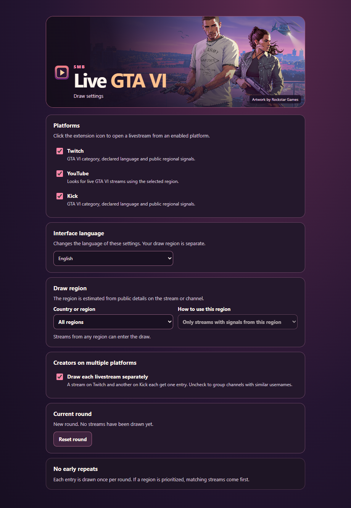

<h1 align="center">SMB Live GTA VI</h1>

Find someone new playing GTA VI live, in one click.

  <strong><a href="https://github.com/smbprdz/plugin-smb-live-gta-vi/releases/latest">Download for Chrome</a></strong> ·
  <a href="README.md">Português</a>

## Install in Chrome

1. Download the `smb-live-gta-vi-<version>.zip` file under **Assets** in the [latest release](https://github.com/smbprdz/plugin-smb-live-gta-vi/releases/latest).
2. Extract the ZIP. Go to `chrome://extensions` and turn on **Developer mode**.
3. Click **Load unpacked** and select the extracted folder that contains `manifest.json`.
4. Pin the extension. Click its icon to open a stream. Right-click the icon and select **Options** to change your settings.

To update, use the same folder and click **Reload** at `chrome://extensions` to keep your preferences and rounds.

## Find a stream

Choose Twitch, YouTube, Kick, or any combination. A click opens a livestream directly in a new tab. Each entry gets one turn before the discovered pool repeats. You can draw each stream separately or group channels by similar usernames.

In **Draw region**, choose all regions or one of 249 countries and territories. For a specific region, you can play matching results first or limit the draw to streams that show signs of a match. Region matching uses public metadata. Results vary by platform and some streams may be missed.

**Interface language** follows Chrome by default. You can select English, Brazilian or European Portuguese, Spanish, French, German, Italian, Japanese, Korean, Simplified or Traditional Chinese, or Russian. This preference is independent of the draw region.

## Source and feedback

This is an independent fan project. The extension is MIT-licensed, requires no project account, and stores preferences and rounds locally in Chrome. Artwork by Rockstar Games. [License](LICENSE) · [Credits](NOTICE.md) · [Privacy (Português)](PRIVACY.md)

Want to report a bug, suggest a better regional signal, or improve a translation? [Open an issue](https://github.com/smbprdz/plugin-smb-live-gta-vi/issues/new/choose) or follow the [contribution guide](CONTRIBUTING.md). Run the offline checks with `node --test`.
