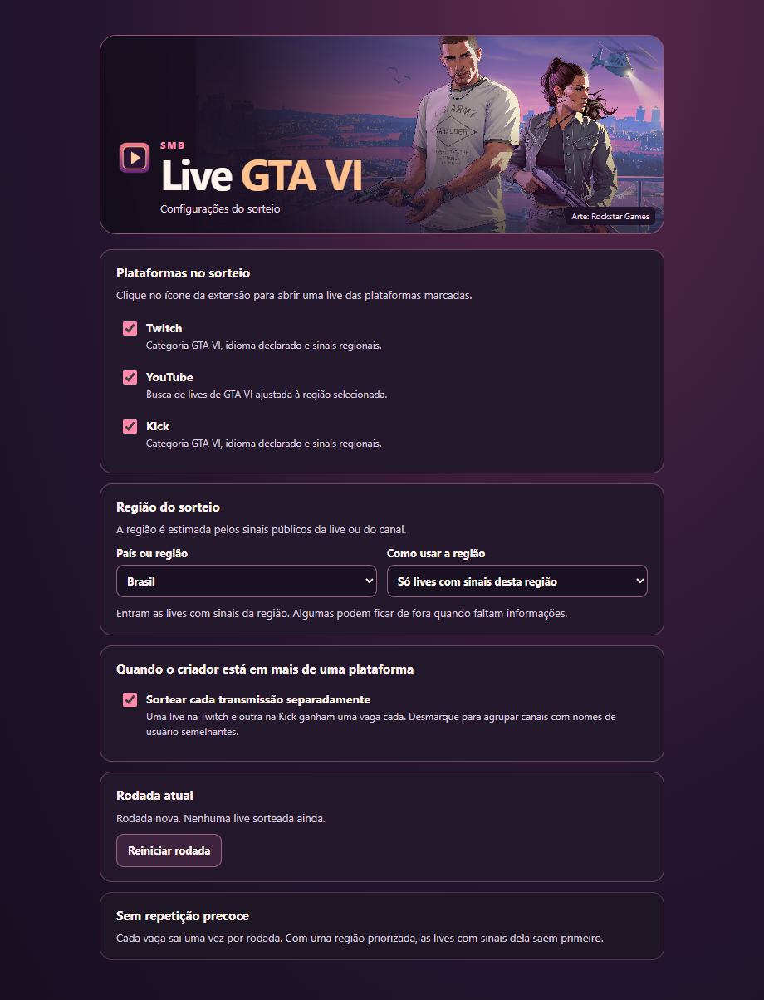

<h1 align="center">SMB Live GTA VI</h1>

Descubra quem está jogando GTA VI ao vivo, com um clique no Chrome.

  <strong><a href="https://github.com/smbprdz/plugin-smb-live-gta-vi/releases/latest">Baixar para Chrome</a></strong> ·
  <a href="#como-funciona">Como funciona</a> ·
  <a href="CONTRIBUTING.md">Contribuir</a>

## Instalação no Chrome

1. Abra a [release mais recente](https://github.com/smbprdz/plugin-smb-live-gta-vi/releases/latest) e baixe o arquivo `smb-live-gta-vi-<versão>.zip` em **Assets**.
2. Extraia o ZIP. Abra `chrome://extensions` e ative o **Modo do desenvolvedor**.
3. Clique em **Carregar sem compactação** e selecione a pasta extraída que contém `manifest.json`.
4. Fixe a extensão na barra do Chrome. Clique no ícone para sortear ou use o botão direito e abra **Opções**.

Para atualizar, coloque os arquivos da release nova na mesma pasta e clique em **Recarregar** em `chrome://extensions`. Usar a mesma pasta preserva as preferências e o histórico.

## Como funciona

O clique consulta **Twitch, YouTube e Kick** em paralelo e abre a live sorteada em nova aba. Você pode ajustar as plataformas, a região e o modo de rodada nas **Opções**.

| Região do sorteio | O que entra na rodada |
| --- | --- |
| **Todas as regiões** | Qualquer live elegível encontrada, independentemente da origem. |
| **País ou território + Priorizar** | As lives com sinais da região saem primeiro. As demais também têm sua vez. |
| **País ou território + Só lives com sinais** | Entram apenas as lives com indícios públicos da região escolhida. Brasil é o padrão. |

Cada vaga sai uma vez antes de a rodada recomeçar, sem peso por audiência. Por padrão, cada transmissão ocupa uma vaga. O modo por criador aproxima a identidade pelo nome de usuário. Cada seleção regional guarda sua própria rodada, e **Reiniciar rodada** limpa a rodada atual.

### Cobertura e sinais regionais

A Twitch e a Kick usam a categoria oficial de GTA VI. O YouTube usa buscas de GTA VI com selo de transmissão em andamento, ajustadas ao país quando selecionado. A extensão usa país declarado, etiquetas e outros sinais públicos. Um idioma compartilhado por vários países, como inglês ou espanhol, sozinho não identifica um país.

Os resultados dependem do que cada plataforma expõe. Uma live pode ficar de fora se a busca não a retornar ou se os metadados forem insuficientes. As **Opções** mostram o resultado da última consulta e sinalizam quando uma plataforma respondeu parcialmente ou ficou indisponível.

## Código aberto

A extensão usa JavaScript e Manifest V3. Preferências e rodadas ficam no navegador. As consultas dispensam login, chave de API e servidor próprio.

| Entrada | Responsabilidade |
| --- | --- |
| [`background.js`](background.js) | Recebe o clique e abre a transmissão sorteada. |
| [`platforms/`](platforms/) | Descobre lives nas três plataformas. |
| [`lib/`](lib/) | Interpreta a região, monta o conjunto e guarda a rodada. |
| [`options.html`](options.html) | Tela de opções. |

Quer relatar um problema ou sugerir uma melhoria? Use os [formulários de Issues](https://github.com/smbprdz/plugin-smb-live-gta-vi/issues/new/choose). Para conferir o histórico e a política de dados, veja o [changelog](CHANGELOG.md) e a [privacidade](PRIVACY.md).

Projeto independente de fãs, derivado do [SMB Live Zomboid](https://github.com/smbprdz/plugin-smb-live-zomboid). Código sob [MIT](LICENSE). A arte oficial de Jason e Lucia é da Rockstar Games. [Créditos](NOTICE.md)
